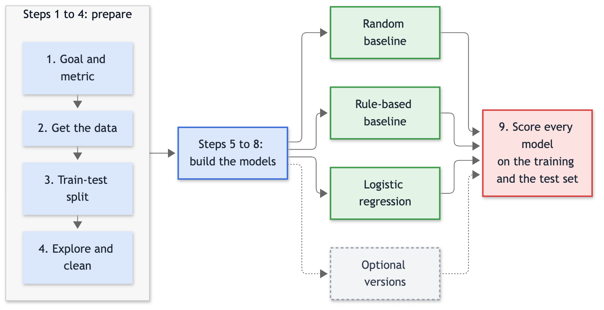
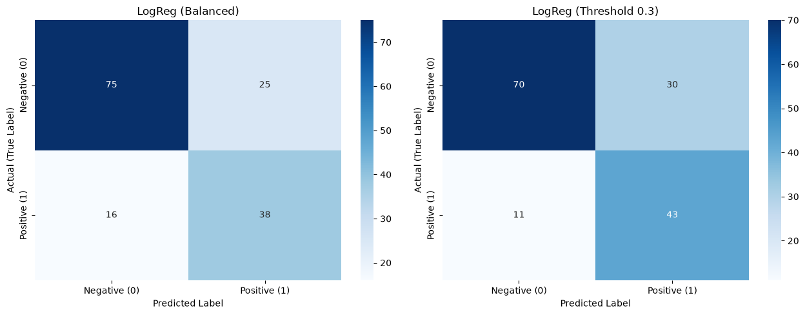
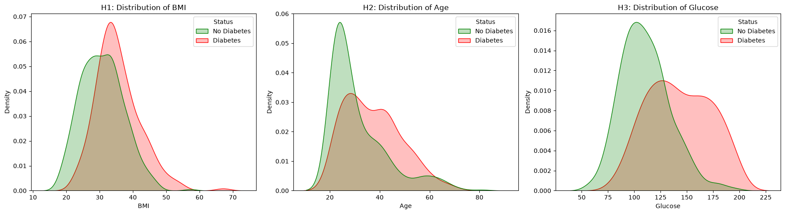

<div align="center">

# 🩺 Diabetes Screening: EDA & Logistic Regression

**A recall-first screening model for the Pima Indians Diabetes dataset.
It catches 4 in 5 diabetes cases with a simple, honest logistic regression.**

[](https://nicolaiturcan.github.io/first_amle_project_diabetes/)
[](01_diabetes_project.ipynb)


</div>

---

## 📌 About the project

Given 8 medical measurements of a patient (glucose, BMI, age, insulin, …), the model predicts whether she has diabetes. It is built as a **screening tool**, and that drives every decision:

> A **missed case** (false negative) leaves a sick patient untreated.
> A **false alarm** (false positive) costs one follow-up blood test.
>
> → The primary metric is **recall**, not accuracy.

The notebook takes a single, disciplined pass through the ML workflow: set the goal and metric → split → explore & clean → test hypotheses → baselines → model → handle imbalance → evaluate once on the test set.



**🌐 Interactive project page:** [nicolaiturcan.github.io/first_amle_project_diabetes](https://nicolaiturcan.github.io/first_amle_project_diabetes/). It has interactive charts, a confusion matrix explorer, the threshold trade-off curve, and a "try the model" calculator that runs the trained coefficients in your browser.

## 🏆 Results

| Model | Train recall | **Test recall** | Test precision | Test F1 | Test accuracy |
|---|---:|---:|---:|---:|---:|
| Random baseline (stratified) | 0.341 | 0.370 | 0.417 | 0.392 | 0.597 |
| Rule-based (glucose > 141) | 0.495 | 0.444 | 0.615 | 0.516 | 0.708 |
| Logistic regression | 0.589 | 0.500 | 0.587 | 0.540 | 0.701 |
| Logistic regression, `class_weight="balanced"` | 0.710 | 0.704 | 0.603 | 0.650 | 0.734 |
| ⭐ **Logistic regression, threshold 0.3** | **0.790** | **0.796** | **0.589** | **0.677** | **0.734** |

- The final model catches **43 of 54** diabetes cases in the test set (**79.6% recall**). The plain logistic regression caught only **50%**, barely more than a one-line glucose rule.
- The price is **11 more false alarms** (30 instead of 19), which a follow-up blood test resolves. For screening, that is the right trade-off.
- Train and test scores are close (0.790 vs 0.796), so the model **does not overfit**.

<p align="center">
  
</p>

## 🔍 Key findings

**Three hypotheses, written before looking at the data**, each tested on the training set with a one-sided **Mann-Whitney U test** (the data is skewed) at a **Bonferroni-corrected α = 0.0167**:

| | Hypothesis | Median: no diabetes → diabetes | p-value | Verdict |
|---|---|---|---:|---|
| H1 | Higher **BMI** → more likely diabetes | 30.5 → 34.3 | 1.7e-15 | ✅ Supported |
| H2 | Older **age** → more likely diabetes | 27 → 36 years | 5.4e-14 | ✅ Supported |
| H3 | Higher **glucose** → more likely diabetes | 108 → 141 mg/dL | 2.3e-34 | ✅ Supported |

<p align="center">
  
</p>

**Found along the way:** biologically impossible zeros hide missing values: **47%** of `Insulin` and **29%** of `SkinThickness` values in the training set are 0. **Glucose** is by far the strongest predictor, followed by BMI and the number of pregnancies.

## 🧠 What makes this analysis solid

- **No data leakage.** The data is split (stratified 80/20) **before** any exploration. Missing values are imputed with **training medians only**, and the same medians are applied to the test set.
- **Honest baselines.** Every model has to beat a random classifier and a rule-based classifier tuned on the training data.
- **Statistics, not eyeballing.** Each hypothesis is backed by a non-parametric test suited to skewed medical data, and the significance level is corrected for multiple testing.
- **Imbalance handled deliberately.** Two methods (`class_weight="balanced"` and a lower decision threshold) were compared. The threshold was chosen on the **training** set, never on the test set.
- **Errors are explained, not just scored.** Confusion matrices show exactly how many cases each version misses.

## 🛠️ Tech stack

| Area | Tools |
|---|---|
| Language | Python 3.13 |
| Data | pandas, NumPy |
| Statistics | SciPy (`mannwhitneyu`) |
| Machine learning | scikit-learn (`LogisticRegression`, `DummyClassifier`, metrics) |
| Visualisation | Matplotlib, Seaborn |
| Environment | Jupyter, uv |
| Project page | HTML, CSS, vanilla JavaScript (hand-built SVG charts), GitHub Pages |

## 📁 Project structure

```
├── 01_diabetes_project.ipynb        # The full analysis: EDA, tests, models, evaluation
├── data/diabetes.csv                # Pima Indians Diabetes dataset (target: Outcome)
├── assets/
│   ├── diabetes_project_workflow.png
│   ├── diagrams/                    # Mermaid source of the workflow diagram
│   └── figures/                     # Plots exported from the notebook
├── docs/                            # Project website (GitHub Pages)
│   ├── index.html
│   └── assets/                      # style.css, app.js, site-data.js
├── scripts/export_site_data.py      # Re-runs the pipeline and exports data for the website
├── paper_on_diabetes_mellitus_data_set.pdf   # Background paper (Smith et al., 1988)
└── pyproject.toml / uv.lock         # Dependencies
```

## 🚀 Getting started

Requirements: [uv](https://docs.astral.sh/uv/). It installs the right Python version automatically.

```bash
git clone https://github.com/NicolaiTurcan/first_amle_project_diabetes.git
cd first_amle_project_diabetes
uv sync
```

Open `01_diabetes_project.ipynb` in VS Code or Jupyter, select the `.venv` kernel, and run **Restart & Run All**.

To regenerate the data behind the website and preview it locally:

```bash
uv run python scripts/export_site_data.py
# then open docs/index.html in a browser
```

## 📚 References

- [Pima Indians Diabetes Database](https://www.kaggle.com/datasets/uciml/pima-indians-diabetes-database) on Kaggle
- Smith, J.W. et al. (1988). *Using the ADAP learning algorithm to forecast the onset of diabetes mellitus.* Proceedings of the Symposium on Computer Applications and Medical Care, 261–265.
- [scikit-learn: LogisticRegression](https://scikit-learn.org/stable/modules/generated/sklearn.linear_model.LogisticRegression.html) · [Precision, recall and F-measures](https://scikit-learn.org/stable/modules/model_evaluation.html#precision-recall-f-measure-metrics)

---

<div align="center">

Built by **Nicolai Turcan** during the AI & ML Engineering Bootcamp (neue fische × SPICED).
*Educational project: not a medical tool.*

</div>
